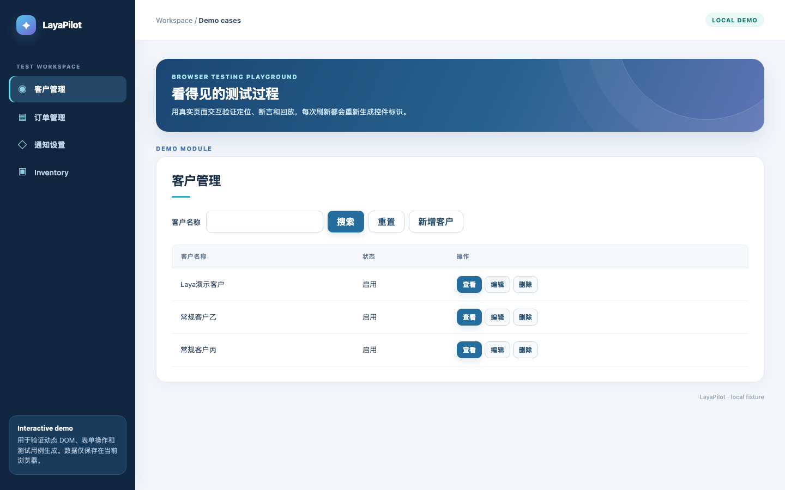

# falcon · Browser Tests for Enterprise Admin Applications

[中文](README.md) · [Changelog](references/changelog.md) · [Download skill](https://github.com/anthonyli/laya-pilot/releases/latest) · [Workflow](docs/workflow.en.md) · [Workflow guide](references/workflows.md) · [Setup](references/setup.md) · [Reading reports](references/reports.md) · [Architecture](docs/architecture.md) · [Issues](https://github.com/anthonyli/laya-pilot/issues)

falcon runs test cases in a browser and produces reports with failure evidence. It targets the tables, filters, forms and CRUD pages of enterprise admin applications.



## What it does

| Feature                    | Input                               | Output                                                   |
| -------------------------- | ----------------------------------- | -------------------------------------------------------- |
| **Regress existing Excel** | Your Excel cases + a page URL       | Per-case results, failed steps, screenshots and traces   |
| **Record new cases**       | A page URL; you act in the browser  | An editable Excel case + the original Playwright script  |
| **Generate from a page**   | A page URL + the allowed operations | New Excel cases that were executed and passed assertions |

Excel replay locates unique controls by name and role. When a step uses different wording, the general locator asks Laya to choose among controls on the current page. Laya uses the **API** by default. Enable the local model explicitly to use it. See the [workflow diagram](docs/workflow.en.md) for how the features fit together.

## Choose how to use it

There are two ways to use falcon. **They are installed separately and do not share configuration.** Pick one:

|               | `fa` command                | AI skill                                                                     |
| ------------- | --------------------------- | ---------------------------------------------------------------------------- |
| Best for      | Running cases yourself, CI  | Giving natural-language tasks in Cursor, Codex and similar tools             |
| Install       | `npm link`, then `fa setup` | Place it in the AI tool's skill directory, then run `node scripts/setup.mjs` |
| Configuration | `~/.falcon/.env.local`      | `.env.local` in the skill directory                                          |
| Commands      | `fa run …`                  | `node scripts/run.mjs …` (usually called by the AI)                          |

The options are identical: `fa X` corresponds to `node scripts/run.mjs X`, and `fa setup` to `node scripts/setup.mjs`.

**Requirements:** Node.js 20+ with npm only. The Python and browser used by Excel features are prepared automatically during installation, see below.

## Command-line quick start

### 1. Install

The falcon DMG bundles the CLI for recording and replay in the desktop app. To use `fa` in a terminal or CI, install the standalone CLI:

```bash
npm install -g github:anthonyli/laya-pilot#v0.2.5
fa --version
```

For development from a source checkout:

```bash
git clone https://github.com/anthonyli/laya-pilot.git
cd laya-pilot
npm install
npm link            # links the fa command and prepares the runtime
```

`npm link` (or `npm install -g`) runs `fa setup` once automatically:

- **Python**: the newest Python 3.10+ on this computer is used; if there is none, a private standalone Python (about 25–70 MB) is downloaded for falcon. Older system versions such as macOS's 3.9 are skipped.
- **Browser**: an installed Playwright Chromium, Chrome or Edge is used first; Chromium is downloaded only when none is found.
- The config file `~/.falcon/.env.local` is created.

It does not run automatically under `sudo`, in CI or with `LAYA_SKIP_SETUP=1`; run `fa setup` yourself then. An incomplete setup (for example a network error) does not fail the installation, and rerunning `fa setup` reuses finished steps. Pick a Python with `fa setup --python python3.12`.

As of v0.2.4, the command is `fa` (previously `laya`). Update scripts to use the new name. The default data directory changed from `~/.laya` to `~/.falcon`. It holds configuration, the Python environment, models and per-site login state. Set `LAYA_HOME` to specify a different directory. Existing data stays in the old directory until you move it yourself.

### 2. Configure the API

Edit `~/.falcon/.env.local`:

```dotenv
LAYA_API_BASE=https://your-gateway.example/v1
LAYA_API_MODEL=laya-decision
LAYA_API_KEY=your-api-key
```

The endpoint must be HTTPS Chat Completions compatible and return the decision JSON this project expects; see the [API protocol](references/setup.md#api-协议). For automatic sign-in, add:

| Setting                              | Purpose                                               |
| ------------------------------------ | ----------------------------------------------------- |
| `TEST_USER`, `TEST_PASSWORD`         | Sign-in account and password                          |
| `TEST_AUTH_STATE`, `TEST_AUTH_CHECK` | Reusable login state file and a signed-in page marker |

Pass the workbook path, page URL and output directory on each run instead of storing them. Never put keys or passwords on the command line.

### 3. Check and run

```bash
fa check                                   # check dependencies and settings (does not contact the gateway)
fa run --excel cases.xlsx --inspect        # check the workbook only, no browser
fa run --excel cases.xlsx --url 'https://your-test-app.example/module' --headless
```

Reports are written to `runs/laya-pilot/<run>/` in the current directory. All commands: `fa --help`.

## Common tasks

### Regress an existing workbook

```bash
fa run --excel cases.xlsx --url 'https://your-test-app.example/module' --headless
```

- Existing workbooks need no conversion. Without cases, copy the [Excel template](assets/test-cases-template.xlsx) and edit its examples following the [template guide](references/case-template.md).
- For menu-only navigation steps, pass `--module-routes routes.json`, for example `{"moduleRoutes":{"Finance → Refunds":"/refunds"}}`. The runner tries the menu first and uses the same-origin URL if the menu is missing. Button actions and visibility checks still use the live page.
- All cases run by default. Steps and expectations are kept as written, and the input workbook is never modified.
- Cases that create, edit or delete data need `--allow-write` in a test environment.

### Record actions as test cases

```bash
fa record 'https://your-test-app.example/customers' --out recorded-cases/filter.spec.cjs
```

1. Perform the workflow in the browser. Laya records your actions in order. Use the toolbar to mark a checkpoint or move the toolbar to the other edge.
2. Finish the recording or close the browser to save `filter.xlsx` (editable cases numbered by business scenario) and `filter.spec.cjs` (the Playwright script). After a successful recorded login, the session and encrypted credentials are saved per site and account. Recording and Excel replay validate the session, sign in automatically when it expires, and save the refreshed session before continuing.
3. The “录制页面” worksheet lists visited same-origin URLs in order, including ordinary query parameters and hash routes. Unrecognized actions are marked in place, with later steps preserved. To generate independent cases, record with `--split-cases`. When replaying, use `--cases REC-001` to run a single case.

```bash
fa replay recorded-cases/filter.xlsx --url 'https://your-test-app.example/customers' --headless
```

For Playwright scripts only, without Excel or a model:

```bash
fa setup --recording                       # install the browser only
fa record 'https://your-test-app.example/customers' --code-only --out recorded-cases/filter.spec.cjs
fa replay recorded-cases/filter.spec.cjs --out runs/filter-check
fa report runs/filter-check                # open the HTML report
```

Sequential recordings add a per-run suffix to eligible new record names and descriptions. Use `${runKey}` in workbook test data to generate other per-run values and reference them from steps and assertions. Convert an earlier recording with `fa export-excel FILE.spec.cjs`. See [Recording and replay](references/recording.md).

### Generate cases from a page

```bash
fa run --mode generate --url 'https://your-test-app.example/module' --read-only
```

falcon explores and executes the page, and exports only cases whose assertions passed, under `generated-cases/`. To review cases before execution, use the [review plan workflow](references/review-plan.md).

### Use a local model

```bash
fa setup --local-model                     # installs dependencies and downloads weights; needs extra disk and memory
fa run --provider local --excel cases.xlsx --url URL --headless
```

Pass `--provider local` on every run. Without it the API is always used; installing weights does not switch the default. See [local model setup](references/setup.md#仅在用户明确要求时本地模型).

## Use as an AI skill

1. Place the whole repository, or the `laya-pilot/` directory from the [Release ZIP](https://github.com/anthonyli/laya-pilot/releases/latest), in your AI tool's skill directory.
2. Run `node scripts/setup.mjs` there, then fill in the API settings (same fields as above) in `.env.local` in that directory.

The `fa` command is not needed. Then give tasks in natural language:

```text
Use $laya-pilot to run every case in /absolute/path/cases.xlsx against https://your-test-app.example/module.
Inspect the parse result first, then run headless and give me the report and failure evidence.

Use $laya-pilot to generate read-only test cases for https://your-test-app.example/module.

Use $laya-pilot to analyze /absolute/path/run/results.json and explain the failed steps.
```

- Given only a URL, the AI first asks whether to generate cases or run an existing workbook.
- Say "remember the login" and the AI saves the login state, then reuses it next time after verifying it.
- Analyzing an existing report needs no dependencies or API settings.

## Reports

Each run creates `runs/laya-pilot/<date_time>/` in the current directory. Share the whole directory:

```text
index.html     start here: reliability verdict, cases, a screenshot for every step
summary.md     text report        results.json   machine-readable   results.xlsx   results table
cases/         one directory per case with a screenshot for every step, e.g. 03-预期2-失败.png
               (third capture, expectation 2, failed); cases that did not pass also keep trace.zip
logs/          process files for troubleshooting
```

Run `fa report` from the directory where you ran the test to open the latest report. Use `fa report RUN_DIR` to open a specific run. The top of the page gives the verdict: **passed with complete evidence**, **passed but needs review** or **failed**, with the reasons, such as blocked cases, unverified expectations, page or API errors, or missing screenshots. A pass count alone does not tell you whether the result can be trusted; read the verdict.

- Generated cases go to `generated-cases/` and include only cases that executed and passed assertions.
- A passing `--inspect` only means the workbook is valid; page assertions decide whether a test passes.
- Use `--out` for the report directory and `--case-file` for the generated workbook.

See [reading reports](references/reports.md) (Chinese).

## Scope

Coverage today focuses on admin tables, filters, forms and CRUD. Complex approvals, multi-account permissions, file imports and Canvas need dedicated support, tracked in [Issues](https://github.com/anthonyli/laya-pilot/issues).

## Try the demo

```bash
npm run demo        # then open http://127.0.0.1:8765/customers
```

The same server hosts a React 16 + Ant Design 3 workspace at `/react-demo/`. Its libraries load from a CDN. Start a recording with `fa record http://127.0.0.1:8765/react-demo/`. Open **Indicator Center → Realtime Indicator**, switch between **Edit Area** and **Run Area**, then return to **Edit Area** and select **Add**. Choose a template in the drawer, fill out the configuration, and save it. Hover over a row icon to see its action. Choose **Go Online** and confirm to see that record in **Run Area**. Data is saved in the current browser.

The demo page and cases are in [examples/](examples/); try `examples/demo-cases.xlsx` with the URL above. [Intro video](https://github.com/user-attachments/assets/940b2562-41ff-47ed-a6e0-e179d4d0847d) · [YouTube](https://www.youtube.com/watch?v=aIZEEcTGM0w)

## Development

```text
bin/           fa command entry
scripts/       execution code (shared by the skill and the CLI), setup and packaging
SKILL.md       AI skill entry
references/    skill usage guides
assets/        config template and Excel case template
examples/      demo page and sample cases
docs/          architecture and technical notes
tests/         automated tests
```

```bash
npm ci
npm test && npm run test:browser && npm run format:check   # format check needs uv
```

Package the skill (creates `dist/laya-pilot-skill.zip`, without demo, tests, README or local configuration):

```bash
npm run skill:package
npm run skill:check                                          # compare the ZIP with the sources
python3 scripts/package_skill.py --install-to /path/to/installed-skill   # upgrade an installed copy, keeping its config and login state
```

See the [runtime guide](docs/local-runtime.md) for more verification options.

[MIT License](LICENSE). Laya, Playwright and model weights follow their own licenses.
