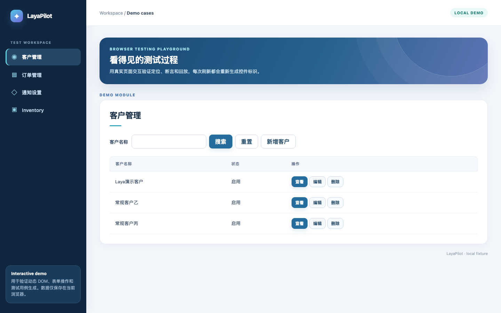

# LayaPilot · Browser Tests for Enterprise Admin Applications

[中文](README.md) · [Workflow guide](references/workflows.md) · [Setup](references/setup.md) · [Architecture](docs/architecture.md) · [Issues](https://github.com/anthonyli/laya-pilot/issues)

Give an AI assistant your existing Excel test cases, execute their original steps and expected results in a browser, and get reports with failure evidence. LayaPilot focuses on admin tables, filters, forms, and CRUD operations. It can also generate new cases after executing and verifying them.

**The repository root is a complete skill, with [SKILL.md](SKILL.md) as its entry point.** Use it through an AI assistant or invoke `scripts/run.mjs` directly. API access is the default; local inference is optional.

## Quick start

You need **Node.js 20+ with npm and Python 3.10+ with venv/pip**. API mode requires no GPU or local model weights. For local inference, follow [Use a local model](#use-a-local-model) instead of the API setup below.

### 1. Install the skill

Clone the complete repository into `laya-pilot/` under your AI tool's skill installation directory, or install the `laya-pilot/` directory from a distribution ZIP. Keep the complete directory structure; no build is required. From the installed skill directory, run:

```bash
node scripts/setup.mjs
```

Setup installs Playwright, Chromium, and Python dependencies, then creates `.env.local` from the [configuration template](assets/.env.example). Existing configuration is preserved.

### 2. Configure API access and login

Fill in `.env.local` at the skill root:

```dotenv
LAYA_API_BASE=https://your-gateway.example/v1
LAYA_API_MODEL=laya-decision
LAYA_API_KEY=your-api-key
```

Set the model name to one supported by your service. The endpoint must support HTTPS Chat Completions and return this project's candidate-decision JSON. Endpoint compatibility alone does not guarantee model compatibility; see the [API protocol](references/setup.md#api-协议).

Keep only persistent API and login settings in `.env.local`. Add login settings as needed:

| Settings                             | Purpose                                                                      |
| ------------------------------------ | ---------------------------------------------------------------------------- |
| `TEST_USER`, `TEST_PASSWORD`         | Credentials for automatic login                                              |
| `TEST_AUTH_STATE`, `TEST_AUTH_CHECK` | Session file path and a unique authenticated-page marker; configure together |

**Supply the workbook, target URL, operation scope, and output location with each task.** See [advanced options](references/setup.md#高级参数) when needed; they do not all belong in `.env.local`. Keep passwords, API keys, and session files out of Git, task prompts, and command lines.

```bash
node scripts/setup.mjs --check
```

This checks dependencies and configuration, not API connectivity. Run `node scripts/run.mjs --version` to inspect the installed version and content digest.

### 3. Ask the AI to run a task

If you only provide a URL or say “test this page,” the AI first asks: **Generate new test cases, or execute an existing Excel workbook?** Generation explores the page and exports verified cases; execution requires a workbook or its path. If your intent is already clear, the AI does not ask again.

In a tool supporting `$skill-name`, provide the workbook and target URL for this run:

```text
Use $laya-pilot to execute every case in /absolute/path/cases.xlsx.
The target URL is https://your-test-app.example/module.
Inspect parsing first, then run headlessly and provide reports and failure evidence.
```

To generate new cases or analyze existing results:

```text
Use $laya-pilot to generate read-only cases for https://your-test-app.example/module.

Use $laya-pilot to analyze /absolute/path/run/results.json and explain failed steps and causes.
```

Complete the first login manually or use configured credentials. Ask the AI to remember the session: it will configure a state file under `.auth/` and an authenticated-page marker, then validate and reuse that session on later runs. Expired sessions require login again. Analyzing an existing report requires no runtime installation or API configuration.

## Run commands directly

If you need a case template, download the [Excel workbook with examples](assets/test-cases-template.xlsx) and follow the [filling guide](references/case-template.md), or ask the AI for a copy. It includes three clearly labeled demo cases for button visibility, customer search, and resetting a filter. Replace or remove them before running against your own application; example rows are not automatically skipped. The template has Chinese headers for case ID, name, preconditions, data, steps, and expected results. Existing workbooks need no conversion, and generating cases from a page does not require filling in a template first.

Use the same installation and configuration above. Run these commands from the skill root, or use absolute script paths when working elsewhere.

```bash
# Inspect a workbook without starting a browser or model
node scripts/run.mjs --excel '/absolute/path/cases.xlsx' --inspect

# Execute existing or generated Excel cases
node scripts/run.mjs --excel '/absolute/path/cases.xlsx' \
  --url 'https://your-test-app.example/module' --headless

# Generate read-only cases from a page
node scripts/run.mjs --mode generate \
  --url 'https://your-test-app.example/module' --read-only
```

Existing and generated cases share `--excel`, with automatic format detection. Input workbooks remain unchanged; new cases are generated only on request. Add `--allow-write` when executing authorized create, update, or delete cases. See the [workflow guide](references/workflows.md) for parameters and login options, or run `node scripts/run.mjs --help`.

## Use a local model

Local inference requires no API configuration and can reuse existing login settings. From the skill root, install dependencies and download the model:

```bash
node scripts/setup.mjs --local-model
node scripts/setup.mjs --check --local-model
```

This downloads `convaiinnovations/laya-multilingual` to `models/laya-multilingual/`, requiring network access and additional disk space and memory. Select local mode explicitly on each run:

```bash
node scripts/run.mjs --provider local \
  --excel '/absolute/path/cases.xlsx' \
  --url 'https://your-test-app.example/module' --headless
```

For an existing compatible model, ensure local inference dependencies are installed and add `--model '/absolute/path/model'` to the run command. No model variables need to be added to `.env.local`. See [local model setup](references/setup.md#仅在用户明确要求时本地模型) for details. **Without `--provider local`, the skill uses the API; installing a model does not change the default.**

## Reports and coverage

Each run creates separate output under the caller's working directory by default:

| Output                     | Default location and contents                                                                     |
| -------------------------- | ------------------------------------------------------------------------------------------------- |
| Regression reports         | `runs/laya-pilot/<run>/`: JSON, Markdown, and available browser evidence                          |
| Workbook execution results | Ordinary cases also produce CSV; generation and structured execution also produce `执行结果.xlsx` |
| Generated cases            | `generated-cases/laya-pilot-*.xlsx`, containing only cases executed with passing assertions       |

Reports retain failures, blocked cases, and coverage gaps. Passing `--inspect` only means file validation succeeded; page assertions determine test results. Use `--out` for a report directory and `--case-file` for the generated workbook's output path.

The current implementation uses Playwright and the Laya decision protocol, primarily covering admin tables, filters, forms, and CRUD. Read-only filter checks verify control visibility, not query results or reset behavior. Complex approvals, multi-account permissions, file imports, and Canvas require dedicated adapters. Follow planned work in [Issues](https://github.com/anthonyli/laya-pilot/issues).

## Try the demo

Start the demo service from the skill root and open `http://127.0.0.1:8765/customers`:

```bash
npm run demo
```

The demo page and sample workbook are in [examples/](examples/). Give the AI `examples/demo-cases.xlsx` and the URL above to run tests within the workbook's scope.



[Introduction video](https://github.com/user-attachments/assets/940b2562-41ff-47ed-a6e0-e179d4d0847d) · [YouTube](https://www.youtube.com/watch?v=aIZEEcTGM0w)

## Project layout and maintenance

```text
SKILL.md       AI skill entry point
scripts/       Setup, execution, demo, packaging, and runtime libraries
references/    Setup and testing workflows
assets/        Configuration and example Excel case templates
examples/      Demo page and sample cases
docs/          Architecture and technical notes
tests/         Automated regression tests
```

The repository maintains one copy of the runtime sources. To distribute the skill or upgrade an installation:

```bash
python3 scripts/package_skill.py
python3 scripts/package_skill.py --check
python3 scripts/package_skill.py --install-to /absolute/path/installed-skill
```

The delivery package contains only `SKILL.md`, runtime scripts, usage references, the configuration template, runtime dependency manifests, and the license. It excludes the demo, tests, GitHub configuration, READMEs, development tools, and the packaging script, as well as local configuration, authentication state, installed dependencies, and model weights. Its npm manifests retain only runtime dependencies and the start command; repository sources remain unchanged.

Packaging creates `dist/laya-pilot-skill.zip` on demand. Git ignores `dist/`; do not commit delivery artifacts. Give recipients the complete extracted `laya-pilot/` directory and follow the installation steps above. `--check` compares an existing ZIP with current sources. Upgrades preserve `.env.local`, `.auth`, dependencies, and models. Afterwards, run `node scripts/setup.mjs` in the installation directory to refresh dependencies. Upgrades remove files listed in the previous manifest that are no longer distributed, including old demo files. Legacy files without a manifest are not automatically removed.

For development, install dependencies with `npm ci`, then run `npm test`, `npm run test:browser`, and `npm run format:check`; formatting checks require `uv`. Python tests and additional verification steps are in the [runtime guide](docs/local-runtime.md).

[MIT License](LICENSE). Laya, Playwright, and model weights have their own licenses.
