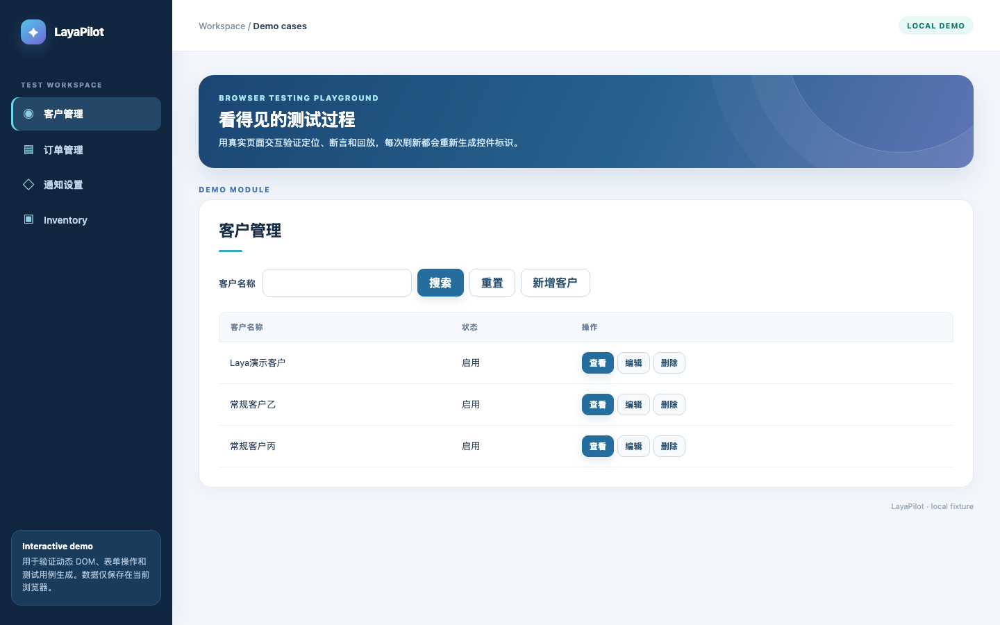

# LayaPilot · 企业管理后台自动化测试

[English](README.en.md) · [更新说明](references/changelog.md) · [下载 skill](https://github.com/anthonyli/laya-pilot/releases/latest) · [工作流程](docs/workflow.md) · [使用指南](references/workflows.md) · [配置说明](references/setup.md) · [看报告](references/reports.md) · [架构](docs/architecture.md) · [Issues](https://github.com/anthonyli/laya-pilot/issues)

LayaPilot 在浏览器里执行测试用例，输出测试报告和失败证据。适用于企业后台的表格、筛选、表单和增删改查页面。



## 能做什么

| 功能               | 输入                       | 输出                                       |
| ------------------ | -------------------------- | ------------------------------------------ |
| **回归已有 Excel** | 你的 Excel 用例 + 页面地址 | 每条用例的结果、失败步骤、截图和执行轨迹   |
| **录制生成用例**   | 页面地址，你在浏览器里操作 | 可编辑的 Excel 用例 + 原始 Playwright 脚本 |
| **从页面生成用例** | 页面地址 + 允许的操作范围  | 实际执行并通过断言的新 Excel 用例          |

执行时由 Laya 决策模型根据当前页面选择控件，默认通过 **API** 调用模型。本地模型需要显式开启。各功能如何串起来，见 [工作流程图](docs/workflow.md)。

## 选择使用方式

有两种用法，**各自独立安装，配置不互通**，按需选一种即可：

|          | 命令行 `laya`                  | AI skill                                                 |
| -------- | ------------------------------ | -------------------------------------------------------- |
| 适合     | 自己跑用例、接入 CI            | 在 Cursor、Codex 等工具里用自然语言下任务                |
| 安装     | `npm link` 后运行 `laya setup` | 放进 AI 工具的 skill 目录后运行 `node scripts/setup.mjs` |
| 配置文件 | `~/.laya/.env.local`           | skill 目录下的 `.env.local`                              |
| 命令写法 | `laya run …`                   | `node scripts/run.mjs …`（通常由 AI 调用）               |

两者参数相同：`laya X` 对应 `node scripts/run.mjs X`，`laya setup` 对应 `node scripts/setup.mjs`。

**环境要求：** 只需要 Node.js 20+（含 npm）。Excel 功能用到的 Python 和浏览器由安装过程自动准备，见下文。

## 命令行快速开始

### 1. 安装

```bash
git clone https://github.com/anthonyli/laya-pilot.git
cd laya-pilot
npm install
npm link            # 链接 laya 命令，并自动准备运行环境
```

`npm link`（或 `npm install -g`）完成后会自动运行一次 `laya setup`：

- **Python**：自动选用本机最新的 Python 3.10+；都没有时，下载一份只给 LayaPilot 用的独立 Python（约 25–70 MB）。系统自带的旧版本（如 macOS 的 3.9）会被跳过。
- **浏览器**：优先使用本机已有的 Playwright Chromium、Chrome 或 Edge，都没有时才下载 Chromium。
- 生成配置文件 `~/.laya/.env.local`。

用 `sudo` 安装、在 CI 中，或设置了 `LAYA_SKIP_SETUP=1` 时不会自动执行，之后手动运行 `laya setup` 即可。网络中断等原因没装完也不影响安装本身，重新运行 `laya setup` 会复用已完成的步骤。需要指定 Python 时用 `laya setup --python python3.12`。

配置、Python 环境和模型都放在 `~/.laya/`，重装 `laya` 不会丢失。需要换目录时设置环境变量 `LAYA_HOME`。

### 2. 配置 API

编辑 `~/.laya/.env.local`：

```dotenv
LAYA_API_BASE=https://your-gateway.example/v1
LAYA_API_MODEL=laya-decision
LAYA_API_KEY=your-api-key
```

接口需兼容 HTTPS Chat Completions，并返回本项目要求的决策 JSON，详见 [API 协议](references/setup.md#api-协议)。需要自动登录时，可以在这个文件里补充以下配置：

| 配置                                 | 用途                                   |
| ------------------------------------ | -------------------------------------- |
| `TEST_USER`、`TEST_PASSWORD`         | 登录账号和密码                         |
| `TEST_AUTH_STATE`、`TEST_AUTH_CHECK` | 复用的登录态文件、登录成功后的页面标记 |

Excel 路径、页面地址和输出目录在每次运行时通过参数传入，不写进配置文件。密钥和密码不要写在命令行里。

### 3. 检查并运行

```bash
laya check                                   # 检查依赖和配置是否齐全（不测试网关连通性）
laya run --excel cases.xlsx --inspect        # 只检查用例文件，不打开浏览器
laya run --excel cases.xlsx --url 'https://your-test-app.example/module' --headless
```

报告写在当前目录的 `runs/laya-pilot/<本轮>/`。查看全部命令：`laya --help`。

## 常用任务

### 回归已有 Excel

```bash
laya run --excel cases.xlsx --url 'https://your-test-app.example/module' --headless
```

- 已有 Excel 不需要转换格式。没有用例时，可以复制 [Excel 模板](assets/test-cases-template.xlsx)，按 [填写说明](references/case-template.md) 修改其中的示例。
- 旧用例只写菜单名称时，可加 `--module-routes routes.json`。例如 `{"moduleRoutes":{"订单管理 → 订单列表":"/orders","退款列表":"/refunds"}}`。进入模块时先找菜单，找不到才使用项目同源 URL。普通按钮操作和菜单可见性检查仍按页面实际状态执行。
- 默认执行全部用例，用例中的步骤和预期保持原样，原工作簿不会被改写。
- 用例包含新增、修改、删除时，需在测试环境中加 `--allow-write`。

### 录制操作，生成用例

```bash
laya record 'https://your-test-app.example/customers' --out recorded-cases/filter.spec.cjs
```

1. 在打开的浏览器里完成操作。Laya 按顺序记录操作，可用「添加检查点」手动标记要验证的内容。
2. 点击「完成录制」或关闭浏览器，保存 `filter.xlsx`（按业务场景编号、依次回放的用例）和 `filter.spec.cjs`（Playwright 脚本）。成功登录后会按站点和账号保存本地会话及加密凭据。下次录制或 Excel 回放先验证会话，过期时自动登录、更新 auth 并继续用例。
3. Excel 的「录制页面」表按顺序列出本次实际访问的同源页面，保留普通查询参数与哈希路由。未识别的操作会在原位置标为「待补录」，后续步骤继续保存。需要独立用例时，录制时加 `--split-cases`。回放 Excel 可加 `--cases REC-001` 单独执行一条用例。

```bash
laya replay recorded-cases/filter.xlsx --url 'https://your-test-app.example/customers' --headless
```

只要 Playwright 脚本、不使用 Excel 和模型时：

```bash
laya setup --recording                       # 只安装浏览器
laya record 'https://your-test-app.example/customers' --code-only --out recorded-cases/filter.spec.cjs
laya replay recorded-cases/filter.spec.cjs --out runs/filter-check
laya report runs/filter-check                # 在浏览器中打开 HTML 报告
```

连续回放时，符合条件的新增名称和描述会自动带上本轮唯一后缀。其他测试值可在 Excel「测试数据」列用 `${runKey}` 生成，并在步骤和预期中复用。之前录好的脚本可以用 `laya export-excel FILE.spec.cjs` 转成 Excel。更多说明见 [录制与回放](references/recording.md)。

### 从页面生成用例

```bash
laya run --mode generate --url 'https://your-test-app.example/module' --read-only
```

LayaPilot 会探索页面并实际执行，只导出断言通过的用例，保存在 `generated-cases/`。需要先审核用例再执行时，使用 [审核草稿流程](references/review-plan.md)。

### 使用本地模型

```bash
laya setup --local-model                     # 安装依赖并下载模型权重，需要较多磁盘和内存
laya run --provider local --excel cases.xlsx --url URL --headless
```

每次运行都要传 `--provider local`。不传时始终使用 API，安装了模型也不会自动切换。详见 [本地模型配置](references/setup.md#仅在用户明确要求时本地模型)。

## 通过 AI skill 使用

1. 把整个仓库，或 [Release ZIP](https://github.com/anthonyli/laya-pilot/releases/latest) 中的 `laya-pilot/` 目录，放进 AI 工具的 skill 目录。
2. 在该目录运行 `node scripts/setup.mjs`，然后在同一目录的 `.env.local` 中填写 API 配置（字段同上）。

不需要安装 `laya` 命令。之后直接用自然语言下任务：

```text
用 $laya-pilot 执行 /absolute/path/cases.xlsx 的全部用例，目标地址是 https://your-test-app.example/module。
先检查解析结果，再无头执行，给出报告和失败证据。

用 $laya-pilot 为 https://your-test-app.example/module 生成只读测试用例。

用 $laya-pilot 分析 /absolute/path/run/results.json，说明失败步骤和原因。
```

- 只给网址时，AI 会先问你要生成用例，还是执行已有 Excel。
- 说“记住登录态”后，AI 会保存登录状态，下次验证有效就直接复用。
- 只分析已有报告时，不需要安装依赖或配置 API。

## 报告

每轮在当前目录生成 `runs/laya-pilot/<日期_时间>/`，整个目录一起发送即可：

```text
index.html     从这里开始：可靠性结论、用例列表、每一步的截图
summary.md     文字版报告        results.json   机器可读结果        results.xlsx   结果表格
cases/         每条用例一个目录，每一步都有截图，如 03-预期2-失败.png；未通过的用例另有 trace.zip（执行轨迹）
logs/          过程文件，排查时再看
```

在执行测试的目录运行 `laya report`，即可打开最新一轮报告。用 `laya report RUN_DIR` 打开指定一轮。页面顶部给出结论：**通过，证据完整** / **通过，但需要复核** / **未通过**，并列出原因，比如阻断、预期未验证、页面或接口报错、截图缺失。只看“通过 N 条”不足以判断结果是否可信，以这一栏为准。

- 生成的用例保存在 `generated-cases/`，只收录实际执行且断言通过的用例。
- `--inspect` 通过只说明用例文件没问题，测试是否通过以页面断言为准。
- 用 `--out` 指定报告目录，用 `--case-file` 指定生成用例的路径。

详见 [测试报告怎么看](references/reports.md)。

## 支持范围

目前主要覆盖后台表格、筛选、表单和增删改查。复杂审批、多账号权限、文件导入、Canvas 等场景需要专项适配，进展在 [Issues](https://github.com/anthonyli/laya-pilot/issues) 跟踪。

## 体验 demo

```bash
npm run demo        # 然后打开 http://127.0.0.1:8765/customers
```

同一个服务的 `/react-demo/` 提供 React 16 + Ant Design 3 工作台，浏览器从 CDN 加载依赖。可直接从工作台首页开始录制。

```bash
laya record http://127.0.0.1:8765/react-demo/
```

点击左侧的 **Indicator Center** 图标，进入 **Realtime Indicator**，依次切换 **Edit Area → Run Area → Edit Area**。点击 **Add**，在抽屉选择模板并填写配置，点击 **Save**。在新记录的操作列悬停可查看编辑、上线及删除图标的名称。点击 **Go Online** 并确认后，可以在 **Run Area** 找到该记录。演示数据保存在当前浏览器。

示例页面和用例在 [examples/](examples/)，可以用 `examples/demo-cases.xlsx` 加上述地址试跑。[介绍视频](https://github.com/user-attachments/assets/940b2562-41ff-47ed-a6e0-e179d4d0847d) · [YouTube](https://www.youtube.com/watch?v=aIZEEcTGM0w)

## 开发

```text
bin/           laya 命令入口
scripts/       执行代码（skill 和命令行共用）、安装和打包脚本
SKILL.md       AI skill 入口
references/    skill 的使用说明
assets/        配置模板和 Excel 用例模板
examples/      demo 页面和示例用例
docs/          架构与技术说明
tests/         自动化测试
```

```bash
npm ci
npm test && npm run test:browser && npm run format:check   # 格式检查需要 uv
```

打包 skill（生成 `dist/laya-pilot-skill.zip`，不含 demo、测试、README 和本机配置）：

```bash
npm run skill:package
npm run skill:check                                          # 检查 ZIP 与源码是否一致
python3 scripts/package_skill.py --install-to /path/to/installed-skill   # 升级已安装的副本，保留其配置和登录态
```

更多验证方式见 [运行指南](docs/local-runtime.md)。

[MIT License](LICENSE)。Laya、Playwright 及模型权重遵循各自的许可证。
