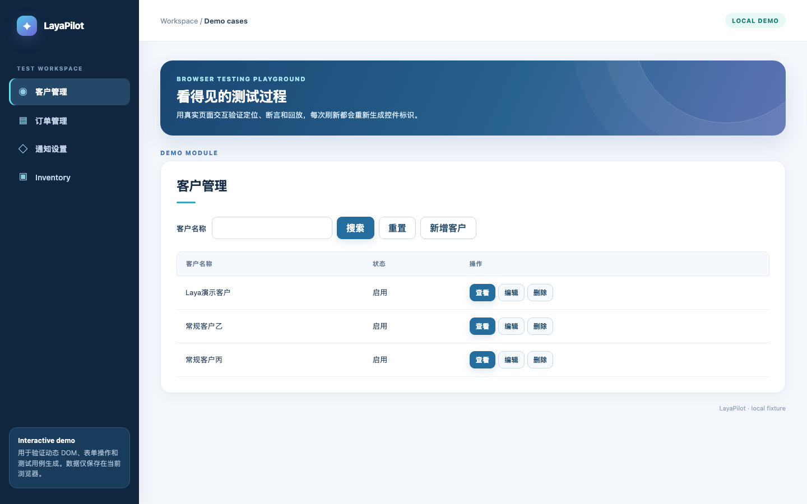

# LayaPilot · 企业管理后台自动化测试

[English](README.en.md) · [使用指南](references/workflows.md) · [配置说明](references/setup.md) · [架构](docs/architecture.md) · [Issues](https://github.com/anthonyli/laya-pilot/issues)

把已有 Excel 测试用例交给 AI，在浏览器中按原步骤和预期执行，获得测试报告与失败证据。LayaPilot 主要面向企业后台的表格、筛选、表单和增删改查，也支持按需从页面生成经过实际验证的新用例。

**仓库根目录就是一个完整 skill，入口为 [SKILL.md](SKILL.md)。** 推荐通过 AI 使用，也可直接运行 `scripts/run.mjs`。默认调用 API，本地模型按需启用。

## 快速开始

需要 **Node.js 20+（含 npm）和 Python 3.10+（含 venv/pip）**。API 模式无需显卡或本地模型权重；选择本地推理时，直接按下方[本地模型](#使用本地模型)一节安装。

### 1. 安装 skill

将完整仓库克隆到 AI 工具的 skill 安装目录下的 `laya-pilot/`，或安装分发 ZIP 中的 `laya-pilot/` 目录。保留整个目录结构，无须先构建。在安装后的 skill 目录执行：

```bash
node scripts/setup.mjs
```

安装脚本准备 Playwright、Chromium 和 Python 依赖，并从 [配置示例](assets/.env.example) 创建 `.env.local`；已有配置保留原样。

### 2. 配置 API 和登录

在 skill 根目录的 `.env.local` 中填写：

```dotenv
LAYA_API_BASE=https://your-gateway.example/v1
LAYA_API_MODEL=laya-decision
LAYA_API_KEY=your-api-key
```

模型名可按服务实际支持的名称修改。接口需兼容 HTTPS Chat Completions，并返回本项目要求的候选决策 JSON；仅接口路径兼容并不代表模型可用，详见 [API 协议](references/setup.md#api-协议)。

`.env.local` 只保存长期使用的 API 和登录配置。以下登录项按需填写：

| 配置                                 | 用途                                         |
| ------------------------------------ | -------------------------------------------- |
| `TEST_USER`、`TEST_PASSWORD`         | 自动登录账号与密码                           |
| `TEST_AUTH_STATE`、`TEST_AUTH_CHECK` | 登录态文件路径与登录后唯一页面标记，配套设置 |

**Excel、目标 URL、操作范围和输出位置由每次任务提供。** 高级选项见 [配置说明](references/setup.md#高级参数)，无需全部写入 `.env.local`。密码、API 密钥和登录态不提交到 Git，也不写进任务指令或命令行。

```bash
node scripts/setup.mjs --check
```

该命令检查依赖和配置是否齐全，不验证 API 连通性。需要核对版本与内容摘要时运行 `node scripts/run.mjs --version`。

### 3. 让 AI 执行任务

如果只提供网址或说“测试一下这个页面”，AI 会先确认：**生成测试用例，还是执行已有 Excel 用例？** 生成会探索页面、验证后导出新用例；执行需要提供 Excel 文件或路径。已经说明目的时不会重复询问。

在支持 `$skill-name` 的工具中，提供本次用例和目标地址：

```text
用 $laya-pilot 执行 /absolute/path/cases.xlsx 的全部用例。
目标地址是 https://your-test-app.example/module。
先检查解析结果，再无头执行，提供报告和失败证据。
```

需要生成新用例或分析已有结果时：

```text
用 $laya-pilot 为 https://your-test-app.example/module 生成只读测试用例。

用 $laya-pilot 分析 /absolute/path/run/results.json，说明失败步骤和原因。
```

首次登录可以人工完成，也可使用已配置的账号。告诉 AI“记住登录态”后，它会配置 `.auth/` 中的状态文件及登录成功标记；下次先验证并复用，失效后重新登录。仅分析报告无需安装运行依赖或配置 API。

## 直接运行命令

没有用例模板时，可下载 [含示例的 Excel 模板](assets/test-cases-template.xlsx)，内含按钮可见、客户搜索、重置筛选三条示例，按 [填写说明](references/case-template.md)修改或删除示例后执行；也可以直接让 AI 提供模板副本。已有 Excel 无需转换，想从页面生成用例时无需先填模板。

安装与配置同上。以下命令在 skill 根目录执行；从其他目录调用时，使用脚本的绝对路径。

```bash
# 检查工作簿，不启动浏览器或模型
node scripts/run.mjs --excel '/absolute/path/cases.xlsx' --inspect

# 执行已有或生成的 Excel
node scripts/run.mjs --excel '/absolute/path/cases.xlsx' \
  --url 'https://your-test-app.example/module' --headless

# 从页面生成只读用例
node scripts/run.mjs --mode generate \
  --url 'https://your-test-app.example/module' --read-only
```

已有用例与生成用例共用 `--excel`，自动识别格式。输入工作簿保持原样；生成用例仅在明确要求时进行。执行已授权的新增、修改、删除用例时加 `--allow-write`。完整参数和登录方式见 [工作流指南](references/workflows.md)，命令帮助为 `node scripts/run.mjs --help`。

## 使用本地模型

本地推理无需 API 配置，账号和登录态仍可复用。首次在 skill 根目录安装依赖并下载模型：

```bash
node scripts/setup.mjs --local-model
node scripts/setup.mjs --check --local-model
```

默认下载 `convaiinnovations/laya-multilingual` 到 `models/laya-multilingual/`，需要网络及额外磁盘、内存。每次执行显式选择本地模式：

```bash
node scripts/run.mjs --provider local \
  --excel '/absolute/path/cases.xlsx' \
  --url 'https://your-test-app.example/module' --headless
```

已有兼容模型时，确保本地推理依赖已安装，并在运行命令中加 `--model '/absolute/path/model'`，无需向 `.env.local` 添加模型参数。详细安装方式见 [本地模型配置](references/setup.md#仅在用户明确要求时本地模型)。**不传 `--provider local` 时仍使用 API；安装模型不会改变默认模式。**

## 报告与支持范围

默认在调用者当前工作目录下创建独立产物：

| 产物           | 默认位置与内容                                                      |
| -------------- | ------------------------------------------------------------------- |
| 回归报告       | `runs/laya-pilot/<本轮>/`：JSON、Markdown 及实际产生的浏览器证据    |
| Excel 执行结果 | 普通用例另有 CSV；生成和结构化执行另有 `执行结果.xlsx`              |
| 新生成用例     | `generated-cases/laya-pilot-*.xlsx`，仅收录实际执行且断言通过的用例 |

报告保留失败、阻断和未覆盖情况。`--inspect` 通过只表示文件检查成功；页面断言才决定测试是否通过。用 `--out` 指定报告目录，用 `--case-file` 指定生成用例的输出路径。

当前使用 Playwright 和 Laya 决策协议，主要覆盖后台表格、筛选、表单和 CRUD。只读筛选检查验证控件可见，不代表查询结果与重置行为正确。复杂审批、多账号权限、文件导入及 Canvas 等流程需要专项适配；后续工作在 [Issues](https://github.com/anthonyli/laya-pilot/issues) 跟踪。

## 体验 demo

在 skill 根目录启动演示服务，打开 `http://127.0.0.1:8765/customers`：

```bash
npm run demo
```

演示页面和示例工作簿位于 [examples/](examples/)。可将 `examples/demo-cases.xlsx` 和上述地址提供给 AI，按用例范围执行测试。



[介绍视频](https://github.com/user-attachments/assets/940b2562-41ff-47ed-a6e0-e179d4d0847d) · [YouTube](https://www.youtube.com/watch?v=aIZEEcTGM0w)

## 项目结构与维护

```text
SKILL.md       AI 使用入口
scripts/       安装、执行、demo、打包脚本及运行库
references/    安装配置与测试工作流
assets/        配置模板与含示例的 Excel 用例模板
examples/      demo 页面与示例用例
docs/          架构与技术说明
tests/         自动化回归测试
```

仓库只维护一份运行源码。需要分发或升级安装副本时：

```bash
python3 scripts/package_skill.py
python3 scripts/package_skill.py --check
python3 scripts/package_skill.py --install-to /absolute/path/installed-skill
```

交付包只保留 `SKILL.md`、运行脚本、使用说明、配置模板、运行依赖清单与许可证；排除 demo、测试、GitHub 配置、README、开发工具和打包脚本，也不包含本机配置、登录态、已安装依赖或模型。包内 npm 清单仅保留运行依赖及启动命令，源码仓库保持不变。

打包按需生成 `dist/laya-pilot-skill.zip`，`dist/` 已由 Git 忽略，不提交交付产物。解压后将整个 `laya-pilot/` 目录交给接收方，按上述安装步骤使用。`--check` 比较已生成 ZIP 与当前源码。升级保留 `.env.local`、`.auth`、依赖和模型，随后在安装目录运行 `node scripts/setup.mjs` 更新依赖。升级会清理旧 manifest 记录中已不再分发的文件，包括旧版 demo；无 manifest 的旧文件不会自动删除。

开发时用 `npm ci` 安装依赖，运行 `npm test`、`npm run test:browser` 和 `npm run format:check`；格式检查需要 `uv`。Python 测试及更多验证方式见 [运行指南](docs/local-runtime.md)。

[MIT License](LICENSE)。Laya、Playwright 及模型权重遵循各自许可证。
