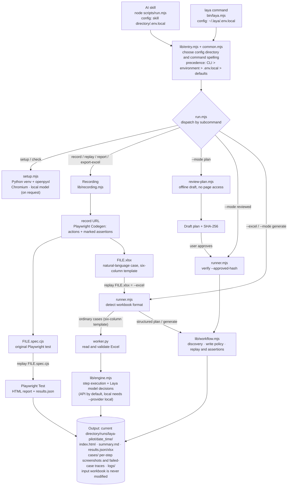

# LayaPilot workflow

[中文](workflow.md) · [Back to README](../README.en.md)

## Overview

## Stages

| Stage            | Entry                                     | What it does                                                                    |
| ---------------- | ----------------------------------------- | ------------------------------------------------------------------------------- |
| Setup and check  | `laya setup` / `laya check`               | Install Python venv, openpyxl and Chromium; check dependencies and API settings |
| Inspect cases    | `laya run --excel FILE --inspect`         | Parse and diagnose the workbook without a browser or model                      |
| Excel regression | `laya run --excel FILE --url URL`         | Ordinary cases: `worker.py` then Engine; structured plans: workflow             |
| Generate cases   | `laya run --mode generate --url URL`      | Explore and execute the page; export only cases whose assertions passed         |
| Review first     | `--mode plan` → `--mode reviewed`         | Draft offline with a digest; execute only after that digest is approved         |
| Record           | `laya record URL`                         | Act in the browser and mark assertions; saves Excel and the Playwright script   |
| Replay           | `laya replay FILE.xlsx` / `FILE.spec.cjs` | Excel goes to the Laya runner; `.spec.cjs` goes to Playwright Test              |

In the skill, replace `laya X` with `node scripts/run.mjs X` and `laya setup` with `node scripts/setup.mjs`.

## Rules

- **Two entries, one execution layer.** The skill and the CLI differ only in config directory and command spelling, and never read each other's configuration.
- **`--excel` routes automatically.** An invalid structured plan is an error; it never falls back to ordinary parsing.
- **Writes need authorization.** Create, edit and delete require an explicit `--allow-write`, including recorded replays.
- **API model by default.** The local model is used only when a run passes `--provider local`.
- **Output goes to the current directory.** Reports in `runs/laya-pilot/<date_time>/`; start with `index.html` (see [reading reports](../references/reports.md)), recordings in `recorded-cases/`, generated cases in `generated-cases/`, all relative to where the command runs.
