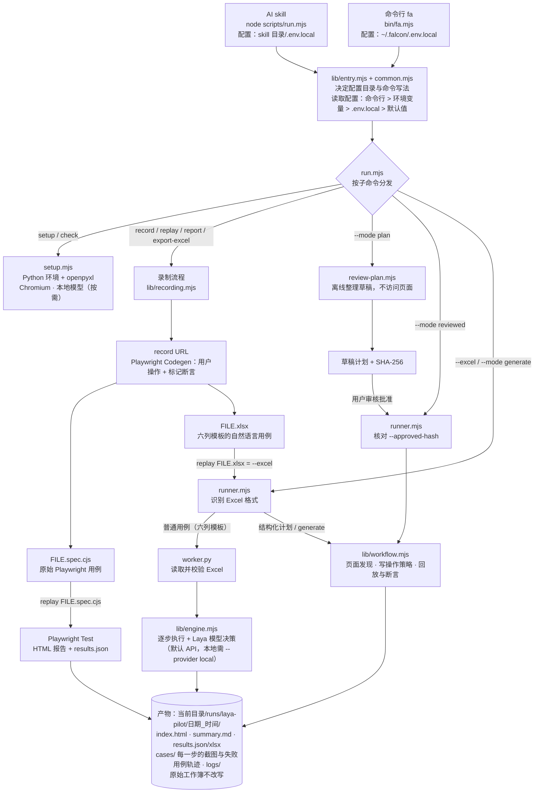

# LayaPilot 工作流程

[English](workflow.en.md) · [返回 README](../README.md)

## 总览

## 各环节说明

| 环节       | 入口                                    | 做什么                                                                  |
| ---------- | --------------------------------------- | ----------------------------------------------------------------------- |
| 安装与检查 | `fa setup` / `fa check`                 | 安装 Python 环境、openpyxl、Chromium；检查依赖和 API 配置是否齐全       |
| 检查用例   | `fa run --excel FILE --inspect`         | 只解析和诊断 Excel，不打开浏览器、不调用模型                            |
| 回归 Excel | `fa run --excel FILE --url URL`         | 普通用例经 `worker.py` 读取后由 Engine 执行；结构化计划由 workflow 执行 |
| 生成用例   | `fa run --mode generate --url URL`      | 探索页面并实际执行，只导出断言通过的用例                                |
| 审核后执行 | `--mode plan` → `--mode reviewed`       | 先离线出草稿和摘要，用户批准该摘要后才执行，审核和执行分开              |
| 录制       | `fa record URL`                         | 浏览器中操作并标记断言，同时保存 Excel 和 Playwright 脚本               |
| 回放       | `fa replay FILE.xlsx` / `FILE.spec.cjs` | Excel 交给 Laya 执行器；`.spec.cjs` 交给 Playwright Test                |

skill 中把 `fa X` 换成 `node scripts/run.mjs X`，`fa setup` 换成 `node scripts/setup.mjs`。

## 关键规则

- **两个入口，一套执行代码。** skill 和命令行只在配置目录与命令写法上不同，配置互不读取。
- **`--excel` 自动分流。** 结构化计划校验失败直接报错，不降级为普通用例执行。
- **写操作需授权。** 新增、修改、删除必须显式加 `--allow-write`，录制回放同样适用。
- **模型默认走 API。** 只有每次运行显式传 `--provider local` 才使用本地模型。
- **产物写在当前目录。** 报告在 `runs/laya-pilot/<日期_时间>/`，从 `index.html` 开始看（见 [测试报告怎么看](../references/reports.md)），录制在 `recorded-cases/`，生成用例在 `generated-cases/`，都相对于执行命令时所在的目录。
